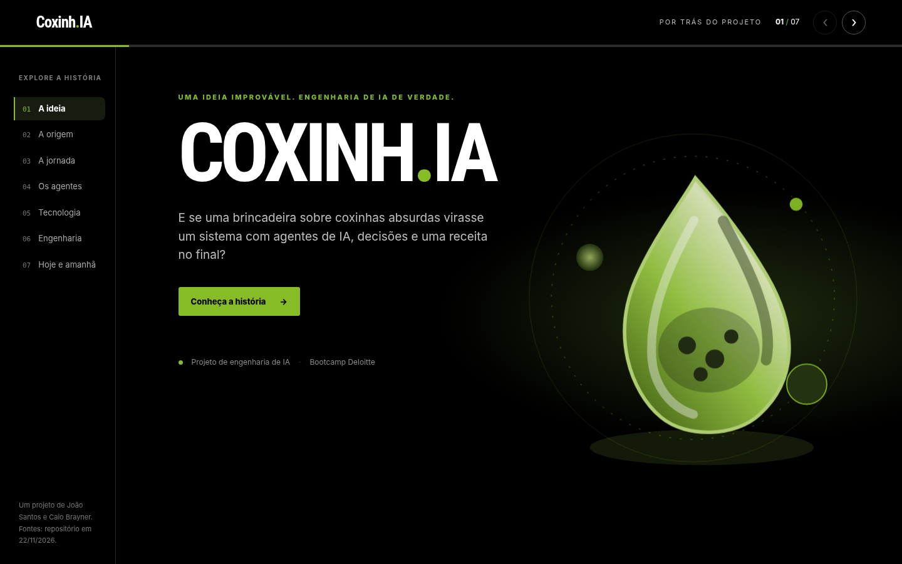

# Coxinh.IA | Showcase interativo

**A história, as ideias e a engenharia por trás de uma coxinha criada por inteligência artificial.**

O Coxinh.IA nasceu de uma brincadeira sobre combinações improváveis de ingredientes durante o bootcamp da Deloitte. João Santos e Caio Brayner transformaram a ideia em um projeto de engenharia de IA para aplicar, na prática, os conceitos estudados: sistemas multiagente, orquestração de fluxos, ferramentas, pesquisa de informações e geração de imagens.

Este repositório apresenta o projeto em formato de **experiência narrativa e interativa**. Não é um curso, uma sequência de exercícios nem a aplicação que cria receitas de verdade.



## O que você encontra aqui

A apresentação é dividida em sete capítulos:

1. **A ideia:** o conceito das coxinhas improváveis e a proposta do projeto.
2. **A origem:** a história da criação durante o bootcamp.
3. **A jornada:** acompanhamento visual de uma solicitação de receita, com cenários simulados.
4. **Os agentes:** papéis de Chef, SubChef, Cozinheiro e Agente de Saúde, além do Impasse.
5. **Tecnologias aplicadas:** LangGraph, LLM, MCP, pesquisa web, imagem e observabilidade, explicadas pelo papel que cumprem.
6. **Engenharia:** decisões de construção e colaboração da dupla.
7. **Estado do projeto:** funcionalidades implementadas, simuladas, limitadas e planejadas.

É possível navegar pelos capítulos e interagir com os cenários para entender o fluxo sem conhecer o código Python.

## Requisitos

Para **visualizar o showcase**, basta um navegador moderno, como Chrome, Edge, Firefox ou Safari.

**Nenhuma instalação é obrigatória:** o projeto usa apenas HTML, CSS e JavaScript. Não precisa de `npm install`, ambiente virtual Python, chaves de API, banco de dados ou backend do Coxinh.IA.

Python é **opcional**, somente se você preferir abrir a apresentação por um servidor HTTP local.

## Como executar

### Opção 1: abrir diretamente

1. Baixe o repositório pelo botão **Code > Download ZIP** no GitHub ou clone-o com Git.
2. Extraia o ZIP, caso tenha baixado um arquivo compactado.
3. Abra o arquivo `index.html` no navegador, com dois cliques.

A apresentação funciona localmente e não depende de uma conexão com o backend do Coxinh.IA.

### Opção 2: servidor local com Python (opcional)

Abra um terminal **na pasta raiz deste repositório**. No Windows, com o Python instalado:

```powershell
py -m http.server 8000
```

Em Linux ou macOS, com Python 3 instalado:

```bash
python3 -m http.server 8000
```

Acesse no navegador:

**http://localhost:8000**

O comando inicia um servidor HTTP simples na porta `8000`, oferecendo os arquivos da pasta atual. Ele **não** executa o sistema de receitas, os agentes ou um modelo de IA. Para encerrar, pressione `Ctrl + C` no terminal.

Se a porta estiver ocupada, substitua `8000` por outra porta livre tanto no comando quanto no endereço do navegador.

## Como navegar

Use o menu lateral para escolher um capítulo, os botões de navegação para avançar ou voltar e os controles das demonstrações para visualizar os cenários. A experiência também foi organizada para telas menores.

**Importante:** as demonstrações são ilustrações executadas pelo JavaScript da página. Os cenários não fazem chamadas de IA nem geram receitas ou imagens reais. O conteúdo representa um retrato documental do projeto, consultado em 22/11/2026, e não acompanha automaticamente mudanças no sistema principal.

## Como publicar com GitHub Pages

Este repositório já usa `index.html` na raiz, como esperado para uma página estática. Depois que os arquivos estiverem em um repositório no GitHub:

1. Abra **Settings** do repositório e entre em **Pages**.
2. Em **Build and deployment**, escolha **Deploy from a branch**.
3. Selecione a branch que contém os arquivos, normalmente `main`, e a pasta **/(root)**.
4. Clique em **Save**.
5. Quando a implantação for concluída, o próprio GitHub exibirá o endereço público do site em **Pages**.

A disponibilidade do GitHub Pages depende das permissões e do plano da conta ou do repositório. Para instruções atualizadas, consulte a [documentação oficial do GitHub Pages](https://docs.github.com/pt/pages/getting-started-with-github-pages/creating-a-github-pages-site).

## Estrutura do repositório

```text
coxinhia-showcase/
├── index.html                  # Apresentação completa: HTML, CSS e JavaScript
├── showcase.config.json        # Briefing editorial e identidade do projeto
├── assets/
│   ├── preview-desktop.png     # Prévia para o README
│   └── preview-mobile.png      # Prévia da versão mobile
├── docs/
│   └── fontes.md               # Documentos que fundamentam a apresentação
├── .gitignore                  # Ignora arquivos locais desnecessários
└── README.md                   # Este guia
```

`showcase.config.json` é um **documento de referência**, não um arquivo carregado automaticamente pela página. Para alterar textos ou interações do showcase atual, edite `index.html`. Para mudar a identidade editorial de uma futura geração, atualize o briefing e gere novamente a apresentação usando a skill genérica `project-showcase`.

## Relação com os outros repositórios

**[Coxinh.IA](https://github.com/Caio-GBrayner/Coxinh.IA):** projeto principal, com backend, fluxos de agentes, regras de negócio, testes e ferramentas.

**Project Showcase:** skill genérica utilizada para orientar a criação de apresentações interativas reutilizáveis. Este repositório contém apenas o resultado específico do Coxinh.IA e **não exige a instalação da skill para funcionar**.

## Identidade visual

A apresentação respeita a direção visual documentada para o Coxinh.IA: fundo preto (`#000000`), branco (`#FFFFFF`), detalhes em verde (`#86BC25`), títulos grandes e composição editorial. O HTML usa uma assinatura tipográfica e uma ilustração próprias; **a marca oficial em PNG ainda não foi incorporada a este pacote**.

A apresentação deve preservar a grafia **Coxinh.IA** e não confundir um aviso informativo sobre consumo com uma certificação de segurança.

## Atualização e fontes

O conteúdo foi organizado a partir do [README do projeto principal](https://github.com/Caio-GBrayner/Coxinh.IA/blob/main/README.md), do [guia visual](https://github.com/Caio-GBrayner/Coxinh.IA/blob/main/docs/design/design.md) e do plano de execução da dupla. O arquivo [`docs/fontes.md`](docs/fontes.md) registra o contexto das referências.

Antes de divulgar novas funcionalidades, confira o código e a documentação do projeto principal. A apresentação distingue recursos que já funcionam de integrações simuladas ou planejadas.

## Autoria

**João Santos e Caio Brayner**, criadores do Coxinh.IA, projeto de estudos de engenharia de IA desenvolvido durante o bootcamp da Deloitte.

Esta apresentação é uma demonstração independente e não representa um produto oficial da Deloitte.
